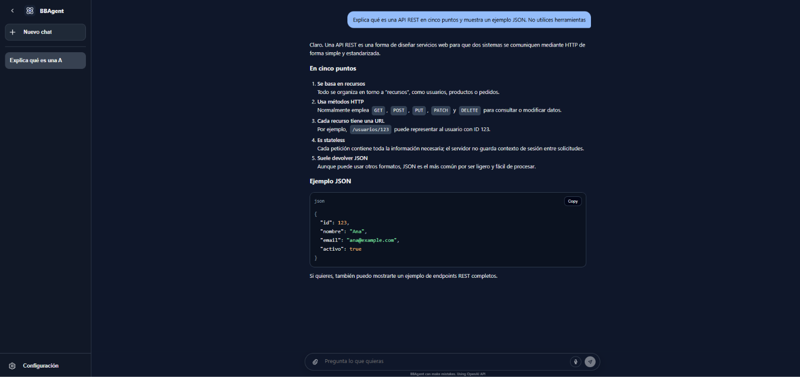
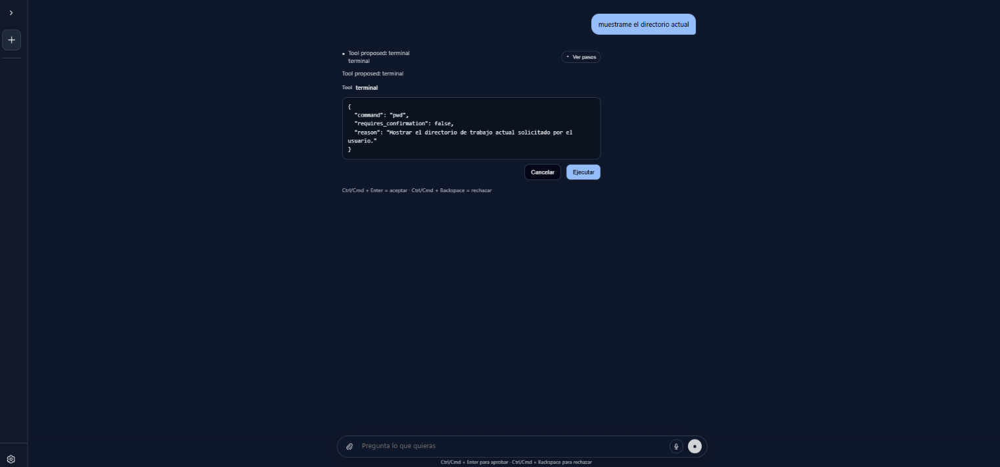
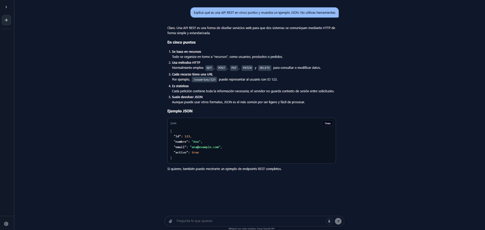
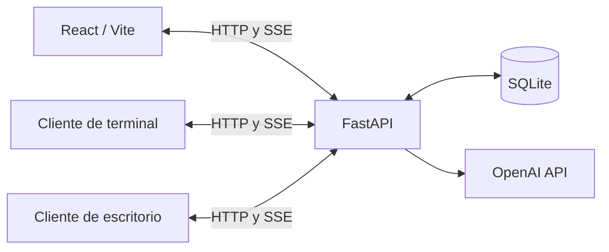

# BBAgent

Asistente personal con interfaz web, respuestas en streaming y herramientas para interactuar con una terminal y un escritorio. Proyecto personal desarrollado por [Marcos Zúñiga Ituarte](https://www.linkedin.com/in/marcos-zuniga-ituarte/).

Combina React y FastAPI con memoria estructurada de conversación y clientes Python que se conectan desde el equipo que se quiere controlar.

## Funcionalidades

- Conversaciones con respuestas en tiempo real mediante Server-Sent Events (SSE).
- Autenticación con contraseñas protegidas mediante Argon2 y sesiones revocables.
- Persistencia de usuarios, mensajes y archivos en SQLite.
- Memoria estructurada para conservar el contexto de las conversaciones.
- Mensajes Markdown con bloques de código y sanitización de HTML.
- Envío de archivos y audio, con transcripción mediante el servicio de modelos.
- Herramientas de terminal Bash y control gráfico mediante clientes independientes.
- Confirmación de herramientas configurable desde la interfaz.

## Interfaz

Conversación con respuesta estructurada y ejemplo de código:



<details>
<summary>Confirmación de herramientas y vista compacta</summary>

Antes de ejecutar una herramienta, la interfaz permite revisar la acción propuesta y aprobarla o cancelarla:



La barra lateral se puede plegar para ampliar el espacio de conversación:



</details>

## Arquitectura



El backend coordina las conversaciones, la memoria y las herramientas. Los clientes ejecutan las acciones en el equipo donde están conectados.

## Tecnologías

| Parte | Tecnologías |
| --- | --- |
| Interfaz | React, Vite, React Router |
| API | Python, FastAPI, Uvicorn, Pydantic |
| Datos | SQLAlchemy, SQLite, Argon2 |
| Agente | OpenAI API, memoria estructurada, llamadas a herramientas |
| Clientes | Python, Bash/PTY, Pillow, PyAutoGUI |
| Pruebas | pytest, ESLint, Node test runner |
| Ejecución | Entornos virtuales, npm, Docker Compose, Nginx |

## Instalación y uso

Necesitas una clave de OpenAI con acceso a los modelos configurados. Para ejecutar sin Docker, utiliza Python 3.12 o 3.13 y Node.js 22.12 o posterior de la rama 22, o Node.js 24 o posterior.

1. Sigue la [guía del backend](backend/README.md) para configurar `.env`, instalar dependencias, crear un usuario y arrancar la API.
2. Sigue la [guía del frontend](frontend/README.md) para configurar la conexión y abrir la interfaz.
3. Inicia sesión y crea una conversación. Para habilitar las herramientas, descarga el paquete de clientes desde la configuración de la web; el ZIP contiene sus instrucciones de instalación y uso.

En la configuración local, la API está en `http://localhost:8000` y la interfaz en `http://localhost:5173`.

## Ejecución con Docker

Necesitas Docker y Docker Compose. Copia `backend/.env.example` a `backend/.env` si aún no existe, sustituye el marcador `OPENAI_API_KEY` por tu clave y revisa los modelos configurados. Los ajustes se explican en el [README del backend](backend/README.md#1-configurar-el-entorno).

Desde la raíz del proyecto:

```bash
docker compose up --build
```

En otra terminal, desde la misma carpeta, crea el primer usuario:

```bash
docker compose exec backend python -m app.cli create-user
```

Abre `http://localhost:5173` e inicia sesión. La API queda disponible en `http://localhost:8000`. Los puertos se publican únicamente en el equipo local y la base SQLite se conserva en `backend/data/bd/local.db`.

Para detener los servicios:

```bash
docker compose down
```

El archivo SQLite se conserva al detener los contenedores. El frontend se sirve como una compilación estática mediante Nginx; para desarrollo con recarga, utiliza las guías de cada componente.

## Estructura

```text
BBAgent/
├── backend/
│   ├── clients/          # Paquete descargable de herramientas
│   ├── data/prompts/     # Instrucciones del agente y la memoria
│   ├── data/tools/       # Definiciones de herramientas
│   ├── src/app/          # API, servicios y acceso a datos
│   ├── src/test/         # Pruebas del backend
│   └── .env.example
├── frontend/
│   ├── public/          # Recursos estáticos
│   ├── src/             # Interfaz web
│   ├── tests/           # Pruebas del frontend
│   └── .env.example
└── docker-compose.yml
```

Los comandos de pruebas y compilación están en los README de [backend](backend/README.md#pruebas) y [frontend](frontend/README.md#pruebas-y-compilación).

## Configuración y datos

La clave de OpenAI se configura únicamente en `backend/.env`. Las variables `VITE_*` del frontend son públicas y no deben contener secretos. El repositorio incluye ejemplos de configuración; los archivos `.env` locales y las bases de datos están excluidos de Git.

Los mensajes, archivos, audio y capturas utilizados por el agente pueden enviarse a OpenAI para procesar las peticiones. La aplicación guarda información de las conversaciones en su base SQLite local.

## Alcance

BBAgent está orientado a uso local. Los clientes actúan con los permisos del usuario del equipo; sus requisitos y compatibilidad se detallan en el README incluido en el ZIP.

La configuración incluida no está preparada para ofrecer un servicio abierto a Internet: no incorpora límites de consumo por usuario ni un despliegue público gestionado. La sesión web utiliza `localStorage`.
